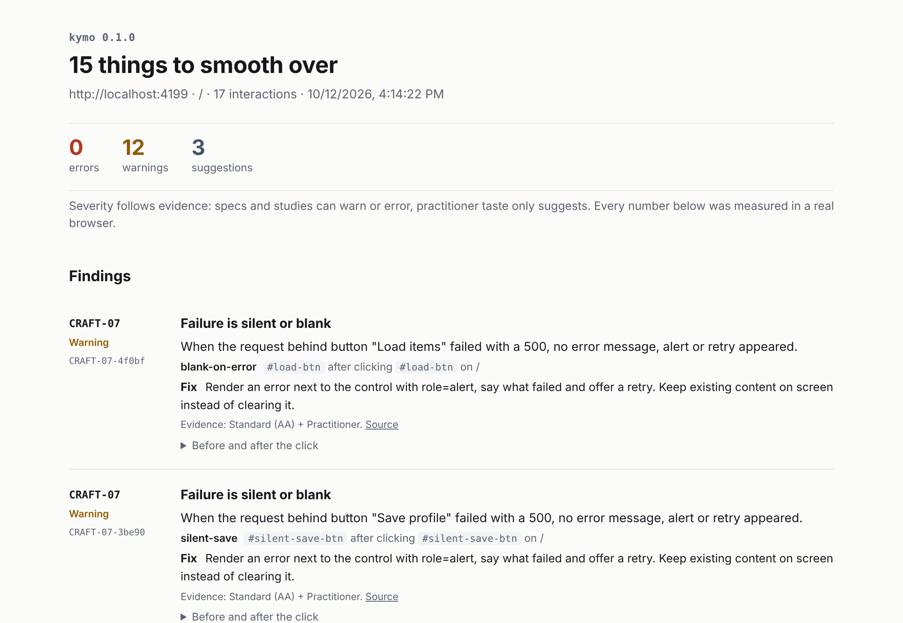

# kymo

Measures how a web app feels in a real browser, then lets Claude fix what it finds and keeps only the fixes that measurably help.

Named after the kymograph, Carl Ludwig's 1847 rotating drum whose stylus turned blood pressure into a line on paper, so physiologists could read change over time instead of guessing by eye.



## Why

Most UI polish skills for coding agents are instructions. The agent reads your code and guesses how the app feels. Code can't show you a button that takes 600 ms to react, a panel that jumps 220 px in one frame, or a save that fails without a word. Screenshots can't either.

kymo runs the app, presses things the way a person would, and measures what happens. Claude only does the part a measurement can't: finding the right file and writing the fix. Then kymo replays the same presses and decides whether the fix stays.

## How it works

```
discover controls -> press each one -> measure -> rank
      -> Claude fixes one finding -> replay the same trace -> keep or revert
```

1. **Discover.** On each route, list the controls a person could click (buttons, toggles, tabs, `summary`, in-page links) and save them as a trace, so later runs press exactly the same things.
2. **Watch idle first.** Each route is watched for a moment with nobody touching it. Carousels, clocks and typed headlines that change on their own are ignored from then on.
3. **Press.** Hover, hold for about 90 ms, release, through Playwright's real input events. An in-page instrument samples element geometry every frame, watches DOM mutations, reads the Web Animations API and records event timestamps for 1.2 s.
4. **Replay under stress.** Presses that fire requests are replayed with the request held for 3 s, then answered with a 500. Presses that move things are replayed with `prefers-reduced-motion: reduce`.
5. **Verify.** `kymo verify` compares two runs of the same trace. A change is kept only if it resolves its target, introduces nothing new (suggestions included), and slows no interaction by more than 50 ms.

## Rules

Severity follows evidence. Specs and studies can warn or error; practitioner taste only suggests.

| Rule | Checks | Threshold | Evidence | Severity |
|---|---|---|---|---|
| FEEL-01 | Slow feedback after a click | No visible change within 100 ms, and no pressed state | Study | warning |
| FEEL-03 | Dead click | Nothing changes within 1 s | Practitioner (RUM vendor rules) | warning |
| MOT-01 | Animation runs too long | Finite UI animation over 500 ms | Standard + Practitioner | warning |
| MOT-03 | Easing does not fit the motion | Entrance that accelerates, or movement on a linear curve | Study + Standard | warning |
| MOT-06 | Movement ignores reduced motion | Translate, scale or position animation still runs under `reduce` | Standard (WCAG 2.3.3) | warning |
| MOT-08 | Animating layout properties | width, height, top, left, margin, padding, or `transition: all` | Standard | warning |
| MOT-09 | Teleport or pop | A jump over 24 px in one frame, or a surface over 2% of the viewport appearing fully formed | Study (design paper) + proposal | suggestion |
| WAIT-01 | No pending state | Request held 3 s, screen unchanged 1 s after the click | Practitioner + Study | warning |
| CRAFT-07 | Silent or blank failure | Request answered with a 500, no error, alert or retry appears | Standard (AA) + Practitioner | warning |
| VIS-08 | Motion token sprawl | More than 8 declared durations or 5 easing curves | Practitioner | suggestion |

`kymo rules` prints the full text, including where each number comes from.

## Results so far


- **Jank zoo** (`zoo/`): 12 planted defects, 5 clean twins and one app-wide defect, with an answer key. kymo finds all 15 expected findings with no false alarms, on three runs in a row. The zoo was built alongside the detector, so treat it as a regression test, not proof.
- **Two real sites, audited as shipped.** On the Fuel Gauge landing page, 4 findings, all confirmed in the source: a 900 ms crosshair transition, `transition: all` on the step numbers, a progress rail animating `height`, and 13 declared durations. On Fallow, 4 findings: 3 confirmed in the source (a meter animating `width` over 900 ms, and 21 declared durations) and 1 likely (a failed sign-in shows no error next to the header button). Early versions raised over 50 findings on these sites. Handling scrolling, SVG redraws, reflow and canvas brought that down, and those fixes were tuned on these same two sites.
- **The fix loop works end to end** (`npm run test:e2e`). A naive fix for the teleporting panel, `transition: left`, removes the teleport but is reverted for animating a layout property. The transform version is kept.
- **A fresh Claude following only the skill** polished a copy of the zoo from 15 findings to 0: 14 fixes kept on the first try and 1 on the second. Measured changes included Like feedback from 615 ms to under 16 ms, Save from 312 ms to under 16 ms, and a 900 ms drawer down to 240 ms. Its notes found a timing bug and shaped the current skill.

## Quick start

```bash
git clone https://github.com/shourya0mehta/kymo && cd kymo
npm install && npx playwright install chromium && npm run build

node dist/cli.js eval                                      # audit the bundled jank zoo and score it
node dist/cli.js audit http://localhost:5173 --routes /,/settings
open .kymo/report.html
```

Commands:

| Command | Does |
|---|---|
| `audit [url]` | Discover, press, measure. Writes `.kymo/latest.json`, `trace.json`, `report.html`. `--fail-on warning` for CI. |
| `audit --trace .kymo/trace.json --only <group,#id,@app> --save-as <name>` | Replay part of a trace. Saved to `.kymo/runs/<name>.json`. |
| `verify --before a.json --after b.json --target <id,id>` | Keep (exit 0) or revert (exit 3). |
| `profile [url] [--as <name>] [--write motion.css]` | Infer a motion profile and write its tokens. |
| `eval` | Audit the jank zoo and print precision and recall. |
| `zoo` | Serve the jank zoo on port 4173. |

A `kymo.config.json` holds `baseUrl`, `routes`, `viewport`, `windowMs`, `exclude` selectors and the optional `groupAttribute` (default `data-kymo-group`), which groups findings by component.

## Use it with Claude Code

Copy `skills/kymo` into `~/.claude/skills/` (or a project's `.claude/skills/`), start your dev server, and ask Claude to polish the app with kymo. The skill walks Claude through it: baseline audit, motion profile approval, a plan grouped by control, one fix at a time on a branch, a targeted replay and `verify` after each, a commit or a revert, and a final full comparison against the first baseline. It also lists what Claude must never do, such as editing thresholds or silencing a finding.

## Motion profiles

When an app has no motion vocabulary yet, `kymo profile` proposes one of four profiles from what the page shows, and writes them as CSS custom properties once the user approves.

| Profile | For | Durations (ms) | Enter / exit / move | From |
|---|---|---|---|---|
| Productive (default) | Dense tools, tables, dashboards | 70 / 150 / 240 | `(0, 0, 0.38, 0.9)` / `(0.2, 0, 1, 0.9)` / `(0.2, 0, 0.38, 0.9)` | IBM Carbon productive; Material 3 standard |
| Expressive | Landing pages, onboarding, big imagery | 240 / 400 / 500 | `(0, 0, 0.3, 1)` / `(0.4, 0.14, 1, 1)` / `(0.4, 0.14, 0.3, 1)` | Carbon expressive; Material 3 Expressive; Apple |
| Calm | Long-form reading, docs | 150 / 250 / 300 | `ease` / `(0.33, 0, 0.67, 1)` / `ease-in-out` | Shopify Polaris; Microsoft Fluent |
| Physical | Touch, drag, sheets | 150 / 300 / 500 | `(0, 0, 0, 1)` / `(0.3, 0, 1, 1)` / `(0.2, 0, 0, 1)` | Apple fluid interfaces; Material 3 |

The inference is a heuristic. On the Fuel Gauge landing page the scores were close, so it fell back to Productive, when Expressive fits better. `--as expressive` overrides it, and the skill always asks the user before writing tokens.

## Prior art and credit

- [MotionLint](https://github.com/bobaba99/motionlint) instruments live animations in headless Chromium and checks them deterministically. kymo's motion inventory overlaps with it.
- [Pixelslop](https://github.com/gabelul/pixelslop) has a fix, re-measure and roll back loop with a checker that cannot edit code. kymo applies the same idea to interaction and motion metrics.
- [impeccable](https://github.com/pbakaus/impeccable), [Emil Kowalski's skills](https://github.com/emilkowalski/skills) and [Vercel's Web Interface Guidelines](https://github.com/vercel-labs/web-interface-guidelines) are where many of these rules are written down. They check them by reading code; kymo measures them.
- Thresholds come from published work: the roughly 100 ms limit for feeling cause and effect (Michotte; Card, Moran and Newell), animated transitions and their costs (Chang and Ungar 1993, Bederson and Boltman 1999, Baudisch et al. 2006, Heer and Robertson 2007), waiting (Myers 1985), WCAG 2.2, Core Web Vitals, and the motion tokens of Material 3, Carbon, Fluent and Polaris.

## What is not built yet

- Clicks only. No hover, keyboard, typing, drag or scroll interactions.
- Discovery sees controls present on load. Controls that appear only after another step, like a dialog's close button, are not pressed.
- No source mapping. Claude finds the file by searching for the element's id, classes and text.
- Canvas and WebGL feedback is invisible to the DOM. A full-viewport pixel diff only stops those from being called dead clicks.
- Duration and easing rules skip animations that start after the click scrolled the page.
- Things that vanish without a transition are not checked, only things that appear.
- The 24 px teleport and 2% pop thresholds are starting points, not validated.
- Chromium only, one viewport per run (1280 by 800 by default), about 2.5 s per interaction.
- No CI action and no checks for the generic "AI-generated" look yet.

## Development

```bash
npm test            # unit tests
npm run test:e2e    # the fix and verify loop against the zoo (about 1.5 minutes)
npm run eval        # zoo precision and recall
npm run zoo         # serve the zoo at http://localhost:4173
```

## License

MIT
