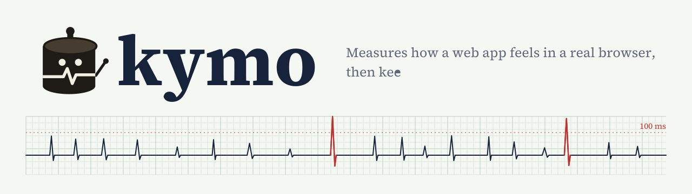
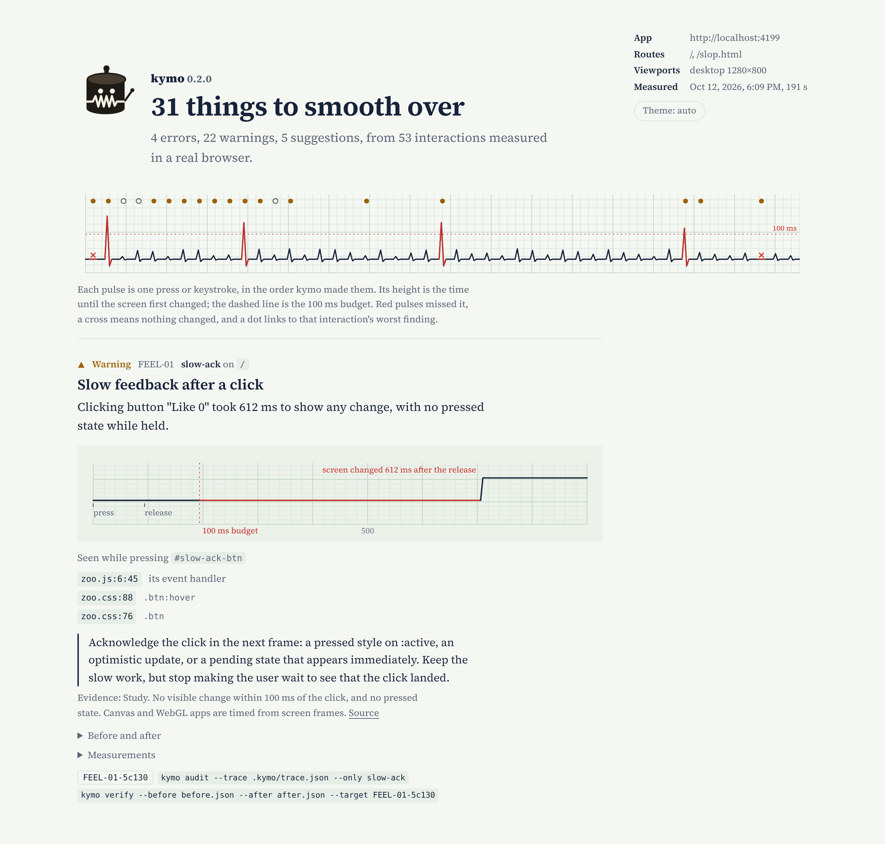
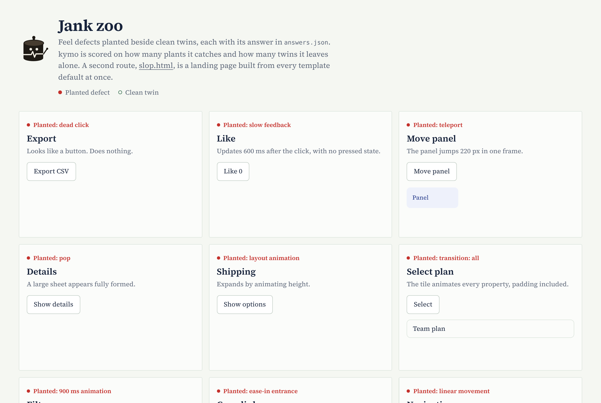

<p align="center">
  <picture>
    <source media="(prefers-color-scheme: dark)" srcset="docs/brand/banner-dark.svg">
    
  </picture>
</p>

kymo drives your running web app in a real browser the way a person would: it presses every control, types into fields, tabs, hovers, opens dialogs and scrolls, on desktop and on a phone. It measures what happens, frame by frame, and points each problem at the CSS rule, handler or line of JSX behind it. Claude fixes one finding at a time, and kymo replays the same interactions to decide whether each fix stays.

It is named after the kymograph, Carl Ludwig's 1847 instrument: a stylus scratching a line into smoked paper on a turning drum, so physiologists could read change over time instead of guessing by eye. The mascot is that drum. Its trace is its mood.

## Why

Most UI polish skills for coding agents are instructions. The agent reads your code and guesses how the app feels. Code can't show you a button that takes 600 ms to react, a panel that jumps 220 px in one frame, a tooltip that vanishes when you reach for it, or a save that fails without a word. Screenshots can't either.

kymo runs the app and measures. Claude only does the part a measurement can't: writing the fix. Then kymo measures again, and a fix that doesn't measurably help is reverted.

## What it checks

Severity follows evidence. Specs and studies can warn or error; practitioner taste only suggests.

| Rule | Checks | Found by | Evidence | Severity |
|---|---|---|---|---|
| FEEL-01 | No visible change within 100 ms of a click, and no pressed state. Canvas and WebGL apps are timed from screen frames. | press | Study | warning |
| FEEL-03 | Dead click: nothing changes within 1 s | press | Practitioner (RUM vendor rules) | warning |
| FEEL-04 | A frame of 100 ms or more after a click or while scrolling | press, page sweep | Standard (Long Animation Frames, INP) | warning |
| FEEL-05 | A typed character takes over 100 ms to show | type | Study | warning |
| MOT-01 | A finite UI animation over 500 ms, after a click or when scrolled into view | press, page sweep | Standard + Practitioner | warning |
| MOT-03 | An entrance that accelerates, or movement on a linear curve | press, page sweep | Study + Standard | warning |
| MOT-06 | Movement still runs under `prefers-reduced-motion: reduce` | press, replayed | Standard (WCAG 2.3.3) | warning |
| MOT-08 | Animating width, height, top, left, margin or padding, or `transition: all` | press | Standard | warning |
| MOT-09 | A jump over 24 px in one frame, or a surface over 2% of the viewport appearing fully formed | press | Study (design paper) + proposal | suggestion |
| MOT-10 | A surface over 2% of the viewport vanishing in one frame with no exit | press | Standard + Practitioner | suggestion |
| WAIT-01 | With the request held for 3 s, the screen is unchanged 1 s after the click | press, replayed | Practitioner + Study | warning |
| CRAFT-07 | With the request answered by a 500, no error, alert or retry appears, or the content goes blank | press, replayed | Standard (AA) + Practitioner | warning |
| STAB-01 | Cumulative layout shift over 0.1 (error over 0.25) from load through a full scroll | page sweep | Standard (Core Web Vitals) | warning |
| STAB-02 | Hovering a control moves or resizes its neighbours | press | Standard + Practitioner | warning |
| CRAFT-02 | Tabbing to a control changes nothing about how it looks, or something covers it | page sweep | Standard (WCAG 2.4.7, 2.4.11) | error |
| CRAFT-03 | A dialog that doesn't take focus, ignores Escape, or doesn't hand focus back | dialog | Standard (WAI-ARIA dialog pattern) | error |
| CRAFT-04 | A control under 24 by 24 px that is crowded by another | page sweep | Standard (WCAG 2.5.8) | error |
| CRAFT-05 | Hover content that vanishes when the pointer moves onto it, or that Escape can't hide | hover | Standard (WCAG 1.4.13) | error |
| CRAFT-08 | An error after one character, before leaving the field | type | Study | warning |
| CRAFT-09 | A control under 44 by 44 px on a touch viewport | page sweep | Standard (Apple HIG, Material) | suggestion |
| VIS-08 | More than 8 declared durations or 5 easing curves | stylesheets | Practitioner | suggestion |
| AI-01 | Three or more template tells on one page: dark glow, violet gradients, gradient headlines, default fonts, glass, identical cards, one radius, emoji icons, eyebrows, stock copy, an entrance on every section | page sweep | Practitioner (opinion) | suggestion |

`kymo rules` prints the full text, including where each number comes from.

## How it works

```
discover ─▶ watch idle ─▶ press · type · hover · open dialogs ─▶ follow what opened ─▶ Tab · scroll
   ─▶ replay slow, failing, reduced-motion, frame by frame ─▶ map to source ─▶ rank
   ─▶ Claude fixes one finding ─▶ replay the same trace ─▶ keep or revert
```

1. **Discover.** On each route and viewport, list the controls a person could press and the fields they could type into, and save them as a trace so later runs do exactly the same things.
2. **Watch idle first.** Each route is watched with nobody touching it. Carousels, clocks and typed headlines that change on their own are ignored from then on.
3. **Interact.** Real input through Playwright: point, hold about 90 ms and release (or tap, on touch viewports); type one character and pause without leaving the field. An in-page instrument samples geometry every frame, watches DOM mutations, reads the Web Animations API, and records layout shifts and long animation frames.
4. **Follow what opened.** Buttons inside a menu or dialog that a press revealed are pressed next, with the steps to reach them saved in the trace. Dialogs are reopened from the keyboard's point of view (does focus move in, does Escape close it, does focus come back), and tooltips are approached with the pointer and then dismissed with Escape.
5. **Sweep the page.** Tab through every stop and check each one shows where focus is; find small, crowded targets; look for the template look; then scroll to the bottom like a reader, measuring layout shift, long frames and reveal animations.
6. **Replay under stress.** Presses that fire requests are replayed with the request held for 3 s, then answered with a 500. Presses that move things are replayed with reduced motion on. Presses that change nothing in the DOM but change pixels are replayed with a screencast, so canvas and WebGL apps get timed too.
7. **Map to source.** Through the DevTools protocol, each finding gets the CSS rules that match its element (following source maps to your files), its event handler, and for long frames, the script position that ate the time. With the optional Babel plugin, the JSX line too.
8. **Verify.** `kymo verify` compares two runs of the same trace. A change is kept only if it resolves its target, introduces nothing new (suggestions included), and slows no interaction by more than 50 ms.

Runs go in parallel (half your cores, at most four pages at once). The same problem on desktop and mobile is one finding, listed with both viewports.

## The report

<picture>
  <source media="(prefers-color-scheme: dark)" srcset="docs/report-dark.png">
  
</picture>

The top strip is the whole session as one recording: a pulse per press or keystroke, taller when the screen took longer to answer, red when it missed the budget. Each finding draws its own kymogram (press, release, the budget, when the screen changed, animations as bars, long frames hatched in red), names the files and lines to look at, and gives the commands to replay and verify it. Light theme is ink on recording paper; dark theme is a scratch through smoked paper.

In the terminal:

```
  ╭─────╮  kymo 0.2.0
  │ • • │  31 findings: 4 error, 22 warning, 5 suggestion
  │╱╲╱╲╱│  53 interactions, 2 routes, desktop
  ╰─────╯

  ● CRAFT-03-046ce  Dialog breaks keyboard focus  dialog-trap
    The dialog opened by button "Delete project...": focus stays behind it when it opens; Escape does not close it.
    at zoo.js:121:42
    replay: --only dialog-trap   verify: --target CRAFT-03-046ce

  ▲ FEEL-04-875e6  Long frame blocks the page  long-task
    After clicking button "Sort by date", one frame took 257 ms. Nothing can paint or respond until it ends.
    at zoo.js:99:41
    replay: --only long-task   verify: --target FEEL-04-875e6

  ○ MOT-10-ecd16  Disappears with no exit  vanish-notice
    div "Your trial ends in 3 days. Add a card to keep this workspace" (2.9% of the viewport) disappeared in a single frame 15 ms after the click, with no exit animation.
    at zoo.js:96:43
    replay: --only vanish-notice   verify: --target MOT-10-ecd16
```

The creature's trace is its mood: a smile when nothing is wrong, a pulse for warnings, jitter for errors. On a terminal it also draws the recording live while it works, one glyph per press, taller when the answer was slower.

## Results so far



- **Jank zoo** (`zoo/`): 24 planted defects and 13 clean twins on one page, plus a second route built from every template default, with an answer key. kymo finds all 31 expected findings with no false alarms. The zoo was built alongside the detector, so treat it as a regression test, not proof. CI runs it on every push.
- **Two real sites, audited as shipped,** on desktop and mobile. Fuel Gauge: 4 findings, 3 confirmed in the source and 1 measured. Fallow: 15 findings, 9 confirmed in the source (three dialogs that mishandle keyboard focus, a canvas that shifts the page as it loads), 1 likely, 3 plausible, 1 measured and 1 timing. Re-checking also showed a v0.1 "confirmed" finding was misattributed. Every finding and its verdict is in [docs/real-sites.md](docs/real-sites.md).
- **The fix loop works end to end** (`npm run test:e2e`). A naive fix for the teleporting panel, `transition: left`, removes the teleport but is reverted for animating a layout property. The transform version is kept.
- **A fresh Claude following only the skill** polished an earlier copy of the zoo from 15 findings to 0: 14 fixes kept on the first try and 1 on the second. Its notes found a timing bug and shaped the current skill.

## Quick start

```bash
git clone https://github.com/shourya0mehta/kymo && cd kymo
npm install && npx playwright install chromium        # npm install also builds dist/

node dist/cli.js eval                                  # audit the bundled jank zoo and score it
node dist/cli.js audit http://localhost:5173 --routes /,/settings --viewports desktop,mobile
open .kymo/report.html
```

| Command | Does |
|---|---|
| `audit [url]` | Discover, interact, measure. Writes `.kymo/latest.json`, `trace.json`, `report.html`. `--viewports`, `--concurrency`, `--fail-on warning`. |
| `audit --trace .kymo/trace.json --only <group,#id,@app> --save-as <name>` | Replay part of a trace. Saved to `.kymo/runs/<name>.json`. |
| `verify --before a.json --after b.json --target <id,id>` | Keep (exit 0) or revert (exit 3). |
| `ci [url] --baseline .kymo/baseline.json --sarif kymo.sarif` | Audit, compare with a baseline, write a summary and SARIF, fail on new findings. |
| `profile [url] [--as <name>] [--write motion.css]` | Infer a motion profile and write its tokens. |
| `eval` | Audit the jank zoo and print precision and recall. |
| `zoo` | Serve the jank zoo on port 4173. |

## Use it with Claude Code

Copy `skills/kymo` into `~/.claude/skills/` (or a project's `.claude/skills/`), start your dev server, and ask Claude to polish the app with kymo. The skill walks Claude through it: baseline audit, motion profile approval, a plan grouped by control, one fix at a time on a branch, a targeted replay and `verify` after each, a commit or a revert, and a final full comparison against the first baseline. It also lists what Claude must never do, such as editing thresholds, silencing a finding or removing a focus ring to make another finding go away.

## Point findings at your JSX

kymo maps findings to CSS rules and handlers on its own. For React apps built with Babel (Vite's React plugin, for example), the bundled plugin also stamps each element with the line that renders it, in development only:

```ts
// vite.config.ts
import react from "@vitejs/plugin-react";
export default { plugins: [react({ babel: { plugins: ["kymo/babel"] } })] };
```

Findings then carry `src/components/SaveButton.tsx:42:7`. Components are left alone; the stamp lands on the DOM elements they render.

## In CI

```yaml
- run: npx vite preview --port 4173 &
- uses: shourya0mehta/kymo@main
  with:
    url: http://localhost:4173
    viewports: desktop,mobile
- uses: github/codeql-action/upload-sarif@v3
  with: { sarif_file: kymo.sarif, category: kymo }
```

A pull request fails only on findings the committed baseline doesn't already have. Findings with a source line become code scanning annotations. More in [docs/ci.md](docs/ci.md).

## Configuration

`kymo.config.json` at the project root:

```json
{
  "baseUrl": "http://localhost:5173",
  "routes": ["/", "/settings"],
  "viewports": ["desktop", "mobile"],
  "exclude": ["[data-danger]"],
  "concurrency": 2,
  "thresholds": { "feedbackMs": 100, "longFrameMs": 100, "maxDurationMs": 500 },
  "probes": { "hover": true, "dialogs": true, "typing": true, "page": true }
}
```

Viewports are `desktop` (1280 by 800), `laptop`, `tablet`, `mobile` (390 by 844, touch) or `WIDTHxHEIGHT`. Every threshold in the rules table can be set; the defaults are the published numbers. `data-kymo-group="<name>"` on a component groups its findings and gives replays a short name. `data-kymo-ignore` skips an element.

## Motion profiles

When an app has no motion vocabulary yet, `kymo profile` proposes one of four profiles from what the page shows, and writes them as CSS custom properties once the user approves.

| Profile | For | Durations (ms) | Enter / exit / move | From |
|---|---|---|---|---|
| Productive (default) | Dense tools, tables, dashboards | 70 / 150 / 240 | `(0, 0, 0.38, 0.9)` / `(0.2, 0, 1, 0.9)` / `(0.2, 0, 0.38, 0.9)` | IBM Carbon productive; Material 3 standard |
| Expressive | Landing pages, onboarding, big imagery | 240 / 400 / 500 | `(0, 0, 0.3, 1)` / `(0.4, 0.14, 1, 1)` / `(0.4, 0.14, 0.3, 1)` | Carbon expressive; Material 3 Expressive; Apple |
| Calm | Long-form reading, docs | 150 / 250 / 300 | `ease` / `(0.33, 0, 0.67, 1)` / `ease-in-out` | Shopify Polaris; Microsoft Fluent |
| Physical | Touch, drag, sheets | 150 / 300 / 500 | `(0, 0, 0, 1)` / `(0.3, 0, 1, 1)` / `(0.2, 0, 0, 1)` | Apple fluid interfaces; Material 3 |

The inference is a heuristic. On the Fuel Gauge landing page the scores were close, so it fell back to Productive, when Expressive fits better. `--as expressive` overrides it, and the skill always asks the user before writing tokens.

## Prior art and credit

- [MotionLint](https://github.com/bobaba99/motionlint) instruments live animations in headless Chromium and checks them deterministically. kymo's motion inventory overlaps with it.
- [Pixelslop](https://github.com/gabelul/pixelslop) has a fix, re-measure and roll back loop with a checker that cannot edit code. kymo applies the same idea to interaction and motion metrics.
- [impeccable](https://github.com/pbakaus/impeccable), [Emil Kowalski's skills](https://github.com/emilkowalski/skills) and [Vercel's Web Interface Guidelines](https://github.com/vercel-labs/web-interface-guidelines) are where many of these rules are written down. They check them by reading code; kymo measures them.
- Thresholds come from published work: the roughly 100 ms limit for feeling cause and effect (Michotte; Card, Moran and Newell), animated transitions and their costs (Chang and Ungar 1993, Bederson and Boltman 1999, Baudisch et al. 2006, Heer and Robertson 2007), waiting (Myers 1985), typing latency (Schmid 2023), inline validation (Wroblewski 2009), WCAG 2.2, Core Web Vitals, Long Animation Frames, and the motion tokens of Material 3, Carbon, Fluent and Polaris.
- The report is set in Source Serif 4 (Adobe, SIL Open Font License), bundled in `assets/fonts`.

## What is not built yet

- No drag, swipe, pinch or long-press gestures, and no keyboard shortcuts beyond Tab and Escape.
- Chromium only. Safari and Firefox render and schedule differently, and some of what feels wrong only happens there.
- Source stamping is React with Babel only. Vue, Svelte and SWC-only builds (Next.js by default) get CSS rules and handlers from the browser, but no markup line.
- Discovery follows one level down (what a press opens), not whole multi-step flows such as checkout.
- Typing checks one character per field. Debounced work that starts later in a word isn't caught.
- The template-look check is opinion with a threshold. It flags a cluster of tells; it can't tell a deliberate choice from a default.
- The 24 px teleport, 2% pop and vanish, and 3-tell thresholds are starting points, not validated.
- It is not fast. Counting the replays, a page with 25 controls on two viewports takes 5 to 10 minutes on a 2-core machine. More cores run pages in parallel (`--concurrency`).

## Development

```bash
npm test            # unit tests
npm run test:e2e    # the fix and verify loop against the zoo (about 2 minutes)
npm run eval        # zoo precision and recall
npm run zoo         # serve the zoo at http://localhost:4173
```

## License

MIT
